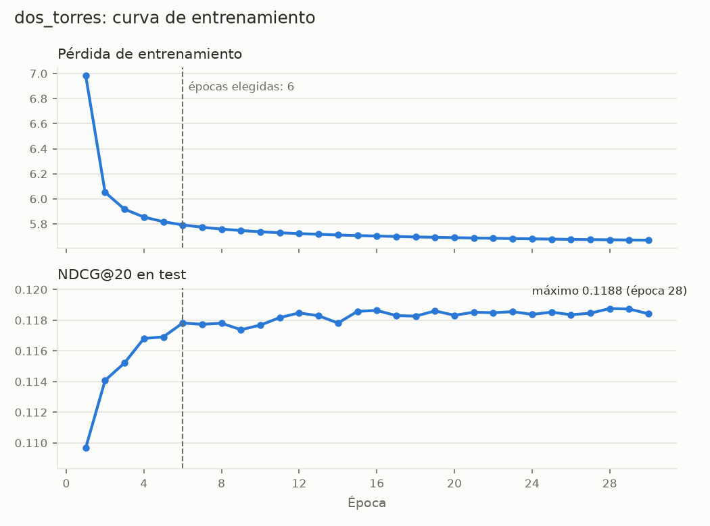

# dos_torres

Optimizado el 2026-11-08T14:58 con 50 trials de Optuna (TPE), maximizando NDCG@20.

## Resultado

| Métrica | Valor |
|---|---|
| NDCG@20 (test) | **0.1178** |
| NDCG@20 de popularidad (referencia) | 0.0889 |
| Lectores del test cubiertos por el modelo | 63.6% |
| Libros del modelo (en la evaluación) | 2996 |
| Tiempo por trial | 6 s |
| Modelo final: interacciones / lectores / libros | 291038 / 3390 / 3645 |

## Hiperparámetros elegidos

| Hiperparámetro | Valor |
|---|---|
| min_lector | 21 |
| min_libro | 18 |
| rating_positivo | 7 |
| dim | 256 |
| temperatura | 0.1518 |
| learning_rate | 0.02218 |
| epochs | 6 |

## Importancia de cada hiperparámetro (fANOVA)

| Hiperparámetro | Importancia |
|---|---|
| min_lector | 0.58 |
| temperatura | 0.15 |
| rating_positivo | 0.13 |
| learning_rate | 0.08 |
| min_libro | 0.05 |
| epochs | 0.01 |
| dim | 0.01 |

## Mejores trials

| # | NDCG@20 | min_lector | min_libro | rating_positivo | dim | temperatura | learning_rate | epochs |
|---|---|---|---|---|---|---|---|---|
| 33 | 0.1178 | 21 | 18 | 7 | 256 | 0.1518 | 0.02218 | 6 |
| 30 | 0.1157 | 20 | 20 | 6 | 256 | 0.1164 | 0.01398 | 4 |
| 32 | 0.1155 | 20 | 20 | 6 | 256 | 0.09912 | 0.03463 | 5 |
| 39 | 0.1154 | 22 | 17 | 7 | 256 | 0.1286 | 0.02237 | 3 |
| 43 | 0.1152 | 21 | 32 | 7 | 256 | 0.1287 | 0.01512 | 7 |
| 35 | 0.1152 | 21 | 28 | 7 | 256 | 0.1034 | 0.01785 | 6 |
| 46 | 0.1141 | 22 | 22 | 5 | 256 | 0.1382 | 0.02273 | 5 |
| 47 | 0.1140 | 23 | 10 | 6 | 256 | 0.1774 | 0.02274 | 6 |
| 23 | 0.1138 | 21 | 35 | 7 | 256 | 0.1487 | 0.02455 | 4 |
| 20 | 0.1133 | 20 | 31 | 6 | 256 | 0.1775 | 0.01406 | 3 |

## Curva de entrenamiento

Con los hiperparámetros elegidos, entrenando sobre train más épocas que las elegidas (6, línea punteada).

| Época | Pérdida | NDCG@20 |
|---|---|---|
| 1 | 6.9856 | 0.1097 |
| 2 | 6.0521 | 0.1141 |
| 3 | 5.9173 | 0.1152 |
| 4 | 5.8548 | 0.1168 |
| 5 | 5.8175 | 0.1169 |
| 6 | 5.7920 | 0.1178 |
| 7 | 5.7731 | 0.1177 |
| 8 | 5.7588 | 0.1178 |
| 9 | 5.7472 | 0.1174 |
| 10 | 5.7373 | 0.1177 |
| 11 | 5.7294 | 0.1182 |
| 12 | 5.7225 | 0.1185 |
| 13 | 5.7170 | 0.1183 |
| 14 | 5.7117 | 0.1178 |
| 15 | 5.7067 | 0.1186 |
| 16 | 5.7033 | 0.1186 |
| 17 | 5.6995 | 0.1183 |
| 18 | 5.6959 | 0.1183 |
| 19 | 5.6933 | 0.1186 |
| 20 | 5.6901 | 0.1183 |
| 21 | 5.6874 | 0.1185 |
| 22 | 5.6853 | 0.1185 |
| 23 | 5.6831 | 0.1186 |
| 24 | 5.6809 | 0.1184 |
| 25 | 5.6786 | 0.1185 |
| 26 | 5.6767 | 0.1184 |
| 27 | 5.6750 | 0.1185 |
| 28 | 5.6734 | 0.1188 |
| 29 | 5.6715 | 0.1187 |
| 30 | 5.6701 | 0.1184 |
