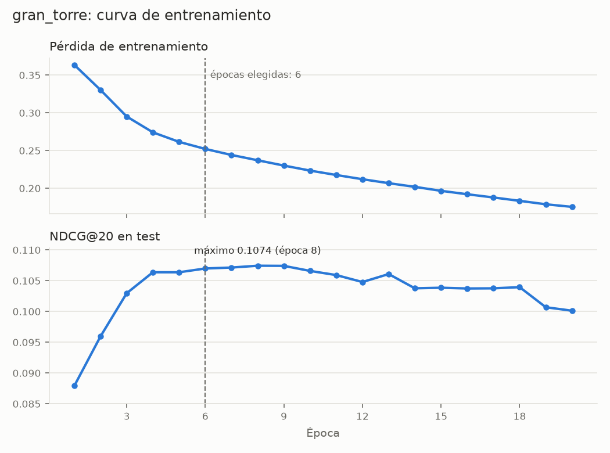

# gran_torre

Optimizado el 2026-11-08T15:15 con 30 trials de Optuna (TPE), maximizando NDCG@20.

## Resultado

| Métrica | Valor |
|---|---|
| NDCG@20 (test) | **0.1070** |
| NDCG@20 de popularidad (referencia) | 0.0889 |
| Lectores del test cubiertos por el modelo | 63.8% |
| Libros del modelo (en la evaluación) | 2364 |
| Tiempo por trial | 35 s |
| Modelo final: interacciones / lectores / libros | 276259 / 3406 / 2880 |

## Hiperparámetros elegidos

| Hiperparámetro | Valor |
|---|---|
| min_lector | 20 |
| min_libro | 23 |
| rating_positivo | 2 |
| negativos | 6 |
| learning_rate | 0.0001407 |
| epochs | 6 |

## Importancia de cada hiperparámetro (fANOVA)

| Hiperparámetro | Importancia |
|---|---|
| min_lector | 0.78 |
| rating_positivo | 0.10 |
| min_libro | 0.07 |
| negativos | 0.02 |
| learning_rate | 0.02 |
| epochs | 0.01 |

## Mejores trials

| # | NDCG@20 | min_lector | min_libro | rating_positivo | negativos | learning_rate | epochs |
|---|---|---|---|---|---|---|---|
| 18 | 0.1070 | 20 | 23 | 2 | 6 | 0.0001407 | 6 |
| 7 | 0.1061 | 22 | 41 | 3 | 7 | 0.0004202 | 6 |
| 19 | 0.1053 | 21 | 33 | 3 | 4 | 0.0002292 | 9 |
| 11 | 0.1052 | 23 | 25 | 1 | 7 | 0.0007228 | 7 |
| 10 | 0.1049 | 20 | 18 | 3 | 9 | 0.0009971 | 6 |
| 22 | 0.1047 | 22 | 40 | 1 | 7 | 0.0001673 | 8 |
| 25 | 0.1038 | 24 | 48 | 3 | 4 | 0.0001736 | 7 |
| 21 | 0.1036 | 20 | 30 | 2 | 2 | 0.0001557 | 10 |
| 24 | 0.1032 | 24 | 21 | 4 | 4 | 0.0004993 | 9 |
| 12 | 0.1031 | 27 | 28 | 4 | 4 | 0.0003058 | 4 |

## Curva de entrenamiento

Con los hiperparámetros elegidos, entrenando sobre train más épocas que las elegidas (6, línea punteada).

| Época | Pérdida | NDCG@20 |
|---|---|---|
| 1 | 0.3636 | 0.0879 |
| 2 | 0.3304 | 0.0960 |
| 3 | 0.2952 | 0.1030 |
| 4 | 0.2742 | 0.1064 |
| 5 | 0.2615 | 0.1064 |
| 6 | 0.2522 | 0.1070 |
| 7 | 0.2442 | 0.1071 |
| 8 | 0.2372 | 0.1074 |
| 9 | 0.2301 | 0.1074 |
| 10 | 0.2235 | 0.1066 |
| 11 | 0.2176 | 0.1059 |
| 12 | 0.2120 | 0.1048 |
| 13 | 0.2068 | 0.1061 |
| 14 | 0.2019 | 0.1038 |
| 15 | 0.1966 | 0.1039 |
| 16 | 0.1921 | 0.1037 |
| 17 | 0.1878 | 0.1038 |
| 18 | 0.1834 | 0.1040 |
| 19 | 0.1788 | 0.1007 |
| 20 | 0.1754 | 0.1001 |
