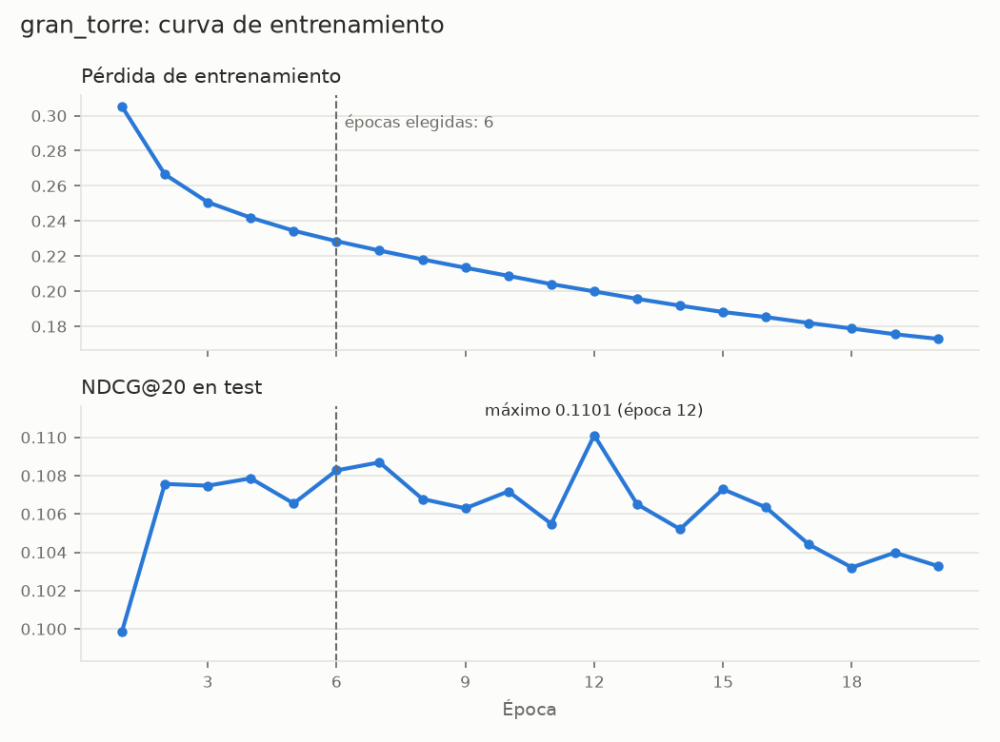

# Intento de mejorar las redes agregando complejidad

**Resultado: no mejoraron. Se volvió a las versiones anteriores de dos torres y gran torre.**

## Motivación

Las curvas de entrenamiento y la literatura ([literatura.md](literatura.md)) sugerían que las
redes podían necesitar más capacidad: en la práctica, las torres de recuperación suelen ser
MLPs sobre el id y los atributos (Yang et al. 2020), y las redes de ranking usan varias capas
en pirámide (Covington et al. 2016, He et al. 2017).

## Qué se probó

Todo como hiperparámetros de Optuna, para que la búsqueda decidiera si conviene usarlo.

**Dos torres**

| Cambio | Valores probados |
|---|---|
| Atributos en las torres | sí / no. Libro: autor, género, editorial, antigüedad. Lector: género, nacimiento, España |
| Capas ocultas por torre | 0, 1 o 2 |
| Ancho de las capas | 128, 256 o 512 |

**Gran torre**

| Cambio | Valores probados |
|---|---|
| Capas en pirámide (cada una la mitad de la anterior) | 1 a 4 (antes: 3 fijas de 256) |
| Ancho de la primera capa | 128, 256, 512 o 1024 |
| Dropout | 0 a 0,5 |
| Nuevos rasgos del lector | `espania` (vive o no en España) |
| Año de edición | antigüedad del libro en escala logarítmica, en lugar del año escalado a 0-1 |

Además se agregaron **curvas de entrenamiento**: con los hiperparámetros elegidos, la red se
reentrena sobre train durante más épocas que las elegidas, midiendo en cada época la pérdida y
el NDCG@20 en test. Las curvas se mantienen en los reportes de cada modelo.

## Resultados (NDCG@20 en test)

| Modelo | Versión anterior | Con complejidad | Arquitectura que eligió Optuna |
|---|---|---|---|
| Dos torres | **0,1178** | 0,1105 (50 trials) / 0,1141 la mejor con atributos (80 trials) | con atributos: dimensión 64, 0 o 1 capa |
| Gran torre | 0,1070 | 0,1083 | 1 capa de 256 (la mínima), dropout 0,05 |

- **Dos torres:** con el espacio ampliado (10 hiperparámetros en lugar de 7), 50 trials no
  volvieron a encontrar la configuración anterior. Al encolarla como punto de partida y correr
  30 trials más, siguió siendo la mejor: ninguna variante con atributos o capas la superó.
- **Gran torre:** la diferencia (+0,0013) está dentro del ruido. De una época a otra el NDCG
  varía ±0,002 sin cambiar nada. Optuna eligió la red más chica posible.

## Por qué no ayudó

**Importancia de cada hiperparámetro (fANOVA):**

| Dos torres (80 trials) | | Gran torre (30 trials) | |
|---|---|---|---|
| temperatura | 0,34 | min_lector | 0,75 |
| min_lector | 0,29 | rating_positivo | 0,08 |
| capas | 0,20 (las capas empeoran) | learning_rate | 0,08 |
| epochs | 0,08 | epochs | 0,03 |
| learning_rate | 0,04 | dropout | 0,03 |
| min_libro, rating_positivo, dim | ≤ 0,02 | min_libro | 0,02 |
| **atributos** | **0,00** | **capas** | **0,01** |
| ancho | 0,00 | **ancho** | **0,00** |

- **Lo que más pesa es el filtro de la base** (cuántos lectores cubre el modelo) y, en dos
  torres, la temperatura. La arquitectura casi no influye.
- **Los atributos no aportan:** autor, género, editorial, antigüedad o vivir en España no
  agregan información a lo que el modelo ya aprende de qué libros lee cada lector.

**Curvas de entrenamiento:**

- **Dos torres sin atributos:** el NDCG sube hasta la época 6 y queda estable en 0,118 ± 0,001
  hasta la época 30. No le falta capacidad ni sobreajusta.
- **Dos torres con atributos:** se estanca en ~0,110 y oscila entre 0,105 y 0,112.
- **Gran torre con complejidad:** el mejor NDCG está entre las épocas 2 y 7. Después la pérdida
  sigue bajando (0,31 → 0,17) pero el NDCG cae hasta 0,103: **sobreajusta**. Agregarle
  capacidad empeoraría eso.

## Conclusión

Con este volumen de datos, el cuello de botella no es la capacidad de las redes sino la
cobertura (cuántos lectores y libros entran al modelo). Coincide con la literatura: Rendle et
al. (2020) encuentran que el producto escalar simple supera a combinar con MLPs, y Ferrari
Dacrema et al. (2019) que muchos modelos neuronales no superan a baselines simples bien
ajustados. En nuestros datos el mejor modelo sigue siendo EASE, que es lineal.
